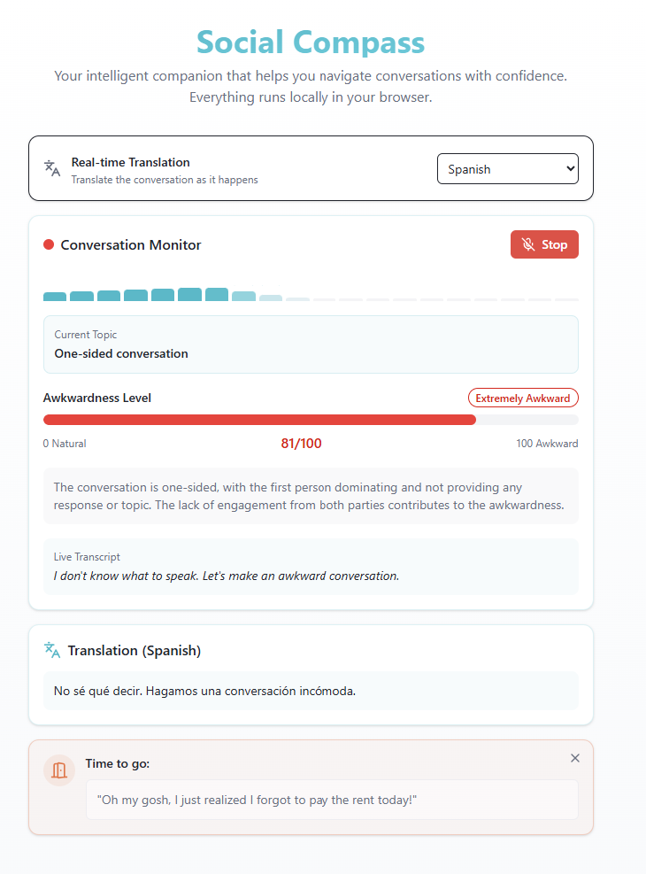

<h1>Social compass</h1>

Your intelligent companion that helps you navigate conversations with confidence using AI-powered awareness monitoring, stress tracking, and real-time translation.

> [!NOTE]
> Built for a hackathon themed around AI-powered tools, where it won **second prize**. Our goal was to build it
> without writing a single line of code ourselves, from the app itself to the final presentation.
>
> This repository is an archived port of the original project. The original relied on Supabase (auth, database, edge
> functions), Azure OpenAI and Gemini; this version keeps the same idea, features and look, but every AI step runs
> locally in the browser.

<p align="center">
  
</p>

## How it works

1. The microphone is recorded in 5 second segments; silent segments are skipped.
2. Each segment is transcribed locally with [Whisper](https://huggingface.co/onnx-community/whisper-base) via [Transformers.js](https://github.com/huggingface/transformers.js).
3. A local LLM ([WebLLM](https://github.com/mlc-ai/web-llm), `Qwen2.5-1.5B-Instruct`) scores the recent transcript from 0 (natural) to 100 (extremely awkward) and detects the topic.
4. Depending on the score:
   - **50-79**: it suggests one question to get the conversation flowing again.
   - **80+**: it generates a dramatic excuse to leave (once per session).
5. Suggestions and excuses are read aloud with the browser's built-in speech synthesis.
6. Optionally, each segment is translated to Spanish or Norwegian.

## Running locally

Requirements: [Bun](https://bun.sh) and a WebGPU capable browser (recent Chrome or Edge).

```sh
bun install
bun run dev
```

The first time you press **Start Monitoring**, the models (~1.2 GB) are downloaded from Hugging Face and cached by the
browser. After that, the app works without any network access.

### Where the models are stored

Models live in the browser's Cache Storage, scoped to the page origin (e.g. `http://localhost:5173`):

| Model                    | Library         | Cache name                                     |
| ------------------------ | --------------- | ---------------------------------------------- |
| Whisper base (speech)    | Transformers.js | `transformers-cache`                           |
| Qwen2.5 1.5B (reasoning) | WebLLM          | `webllm/model`, `webllm/config`, `webllm/wasm` |

- Inspect or delete them in DevTools → **Application** → **Cache storage**, or free everything with **Storage** → **Clear site data**.
- Each origin has its own cache, so a different port (e.g. `bun run preview` on `4173`) downloads the models again.
- The browser may evict the cache under disk pressure; in that case the models are simply downloaded again.

